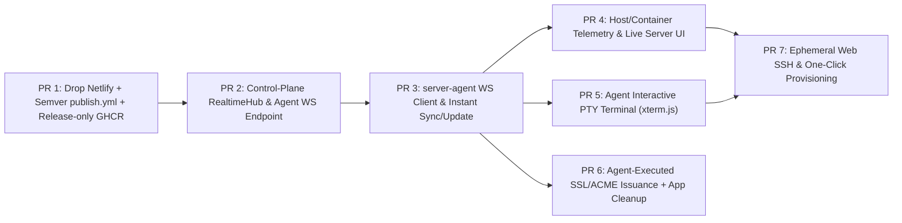

# Worktree PR Roadmap: Agent WS, Semver Release, Agent ACME & Ops UI

**Parent spec:** [Investigation Report](investigation-report.md)  
**Standards:** [`AGENTS.md`](../../../AGENTS.md), [Development Handbook](../../development/README.md), [Workflow](../../development/workflow.md)

This roadmap splits the redesign into **7 independently reviewable pull requests (PR 1–PR 7)** built across isolated sibling worktrees (`../blossom-<suffix>`). Every PR leaves `main` green (`App tests and build` + `Server agent tests`), preserves existing security/publish-gate invariants, and avoids long-lived unmerged branches.

---

## 1. Dependency DAG & Parallelism

**Execution waves:**

- **Wave 1 (Foundation, parallelizable after P1 or P1 first to prevent CI Netlify churn):**
  - **PR 1** can run immediately and independently (CI/release/target cleanup).
  - **PR 2** can start immediately in parallel once shared WS contract types are agreed, or rebase right after PR 1 merges so it does not have to maintain `build:netlify`.
- **Wave 2 (Agent WS Core):**
  - **PR 3** depends on PR 2 (control-plane WS endpoint & contract schemas).
- **Wave 3 (High-parallelism Feature Lanes after PR 3 merges!):**
  - **PR 4** (Telemetry), **PR 5** (Agent PTY), and **PR 6** (Agent ACME) all build on PR 3's multiplexed WS channel and can run in **parallel worktrees**, provided shared files (`app/messages/*.json`, `app/drizzle/`, `server-agent/openapi/spec*.json`, `pnpm-lock.yaml`) are serialized by the controller during integration.
- **Wave 4 (Ops Bootstrap):**
  - **PR 7** reuses `xterm.js` UI components from PR 5 and server live-status indicators from PR 4.

---

## 2. Shared-Resource & Worktree Rules

Follow [Worktrees and resource reuse](../../development/workflow.md#worktrees-and-resource-reuse) for every PR:

- **Worktree paths:** `git worktree add -b <branch> ../blossom-<suffix> origin/main` (or the prerequisite integrated commit). On Linux Btrfs, optionally seed `server-agent/target` via `cp -a --reflink=always` when the source target is idle; run independent `pnpm install --frozen-lockfile --prefer-offline` per worktree.
- **Exclusive shared-resource locks (never merge concurrently without controller serialization):**
  1. `app/drizzle/` (`db:generate` snapshots/journals) → PR 2 (if WS telemetry/metadata columns added), PR 4, PR 6.
  2. `app/messages/en.json` and `app/messages/zh-cn.json` → PR 4, PR 5, PR 6, PR 7.
  3. `server-agent/openapi/spec*.json` (and port `3000` for `agent:spec`) → PR 2, PR 6 (only if OpenAPI endpoints change).
  4. `pnpm-lock.yaml` & `app/vite.config.ts` → PR 1, PR 2, PR 5, PR 6, PR 7.
- **CI branch protection invariant:** Every PR must keep exact job display names **`App tests and build`** and **`Server agent tests`** in `.github/workflows/test.yml` passing.

---

## 3. PR Breakdown

### PR 1: Drop Netlify + Semver `publish.yml` & Release-Only Images

- **Branch / Worktree:** `chore/release-workflow-drop-netlify` / `../blossom-release-workflow-drop-netlify`
- **Base:** `origin/main`
- **Primary Goals:**
  1. Remove Netlify target (`netlify.toml`, `build:netlify` in `app/package.json`, `netlify` preset/output mapping in `app/vite.config.ts`, Netlify build step in `.github/workflows/test.yml`, README/docs references).
  2. Adopt `[Category] Action Object` workflow display names across `.github/workflows/` while keeping CI job names **`App tests and build`** and **`Server agent tests`** intact.
  3. Add `.github/workflows/publish.yml` (`[Release] Prepare Version and Release`), `cliff.toml`, `cliff-agent.toml` (or scoped tag filters), and `scripts/src/release.ts` supporting `target` (`app` | `server-agent` | `both`), `versionType`, and `preid` (`beta` | `rc`).
  4. Support GitHub App bypass actor (`RELEASE_APP_ID` / `RELEASE_APP_PRIVATE_KEY`) with GraphQL `createCommitOnBranch` for protected `main`, plus an explicit release-PR fallback when App secrets are unset.
  5. Update `.github/workflows/docker.yml` (`[Release] Build and Publish Container Images`) to remove `push: branches: [main]` and trigger on published releases / `v*` + `server-agent-v*` tags / manual dispatch; align `.github/workflows/server-agent-release.yml` (`make_latest: false` preserved).
- **Files Owned:**
  - Delete: `netlify.toml`
  - Modify: `.github/workflows/{test.yml,docker.yml,server-agent-release.yml}`, `app/package.json`, `app/vite.config.ts`, `package.json`, `README.md`, `docs/development/{architecture,testing,workflow}.md`
  - Create: `.github/workflows/publish.yml`, `cliff.toml`, `cliff-agent.toml`, `CHANGELOG.md`, `server-agent/CHANGELOG.md`, `scripts/src/release.ts`, unit tests for version bumping & tag validation
- **Guide Rules Touched:** `workflow.md` (`[Category] Action Object`, branch protection job names, atomic commits), `testing.md` (build all remaining deploy targets).
- **Acceptance & Verification:**
  - `pnpm test`, `pnpm build` (Cloudflare), `build:node`, `build:vercel` pass.
  - `release.ts` unit tests cover `major/minor/patch/pre*` transitions for both `app` (`v*`) and `server-agent` (`server-agent-v*`) and `Cargo.toml`/`Cargo.lock` sync.
  - Workflow YAML syntax linted (`actionlint` if installed) and `docker.yml` no longer runs on `push` to `main`.

---

### PR 2: Control-Plane `RealtimeHub` & Agent WebSocket Contract

- **Branch / Worktree:** `feat/control-plane-agent-ws` / `../blossom-control-plane-agent-ws`
- **Base:** Integrated PR 1 (or `origin/main` + rebase after PR 1)
- **Primary Goals:**
  1. Define shared WS frame/envelope Zod schemas in `packages/contracts/` (`agent-ws.ts`) covering `hello`/`welcome`, `config.notify`/`config.ack`, `update.trigger`/`update.status`, `telemetry`, `pty`, and `acme` subchannels.
  2. Implement `RealtimeHub` port and runtime adapters:
     - `NodeRealtimeHub` (`nitro` `crossws` on `node-server` + optional `REDIS_URL` pub/sub backplane).
     - `CloudflareRealtimeHub` (`AgentSessionDO` Durable Object with WebSocket Hibernation declared in `app/wrangler.jsonc` and exported from `app/src/server.ts`).
     - `VercelRealtimeHub` (`nitro` `crossws` Fluid Compute WS handler with proactive pre-`maxDuration` reconnect hint + optional `REDIS_URL` backplane).
  3. Add authenticated agent WebSocket endpoint `/api/agent/ws` reusing `hashAgentToken(parseBearerToken(...))` (reject invalid/disabled servers cleanly; record `lastSeenAt` / `transportMode` / `wsConnectedAt`).
  4. Wire publish-gate mutations (`recordConfigChange` callers) and server update mutations to emit best-effort `config.notify` / `update.trigger` via `RealtimeHub` **without weakening `publish-gate` SQL guarantees**.
- **Files Owned:**
  - Create: `packages/contracts/src/agent-ws.ts`, `app/src/lib/realtime-hub*.ts`, `app/src/routes/api/agent/ws*.ts`, `app/src/durable-objects/agent-session.ts` (for Cloudflare)
  - Modify: `app/vite.config.ts` (`features: { websocket: true }` for Nitro), `app/wrangler.jsonc`, `app/src/server.ts`, `app/src/db/proxy-schema.ts` (+ Drizzle migration if `transportMode` / `wsConnectedAt` persisted), `app/src/query/agent.ts`, `app/src/query/config-change.ts`, `app/src/query/servers.ts`
- **Guide Rules Touched:** `architecture.md` (publish gate, `agent.*` boundary, multi-target runtimes), `api-data-auth.md` (migrations, env vars), `typescript.md` (module boundaries, strict types).
- **Acceptance & Verification:**
  - `pnpm test`, `pnpm --filter @blossom/app exec tsc --noEmit`, `pnpm build`, `build:node`, `build:vercel` pass.
  - Unit tests verify token rejection, hub routing, `config.notify` trigger without breaking `publish-gate`, and local `node .output/server/index.mjs` + `wrangler dev --local` WS upgrade smoke test.

---

### PR 3: `server-agent` WebSocket Client, Multiplexer & Instant Sync/Update

- **Branch / Worktree:** `feat/server-agent-ws-client` / `../blossom-server-agent-ws-client`
- **Base:** Integrated PR 2
- **Primary Goals:**
  1. Add `tokio-tungstenite` (with `rustls` TLS — reusing existing `rustls` / `ring` stack, no `native-tls` bloat) and a trait-abstracted WS transport module `server-agent/src/ws/` (`ports.rs`, `adapters.rs`, `codec.rs`, `mod.rs`).
  2. Connect to `<AGENT_URL>/agent/ws` (derived from `--url` / `AGENT_URL`), perform `hello`/`welcome` capability negotiation (`ws-v1`), and handle reconnects with exponential backoff + jitter.
  3. Feed incoming `config.notify` and `update.trigger` frames directly into `config.rs` / `update.rs` reconcilers (`AgentPolicy`), emit real-time `update.status` transitions (`checking` → `downloading` → `verifying` → `applying` → `restarting`), and immediately push `config.ack` after probation.
  4. Retain automatic HTTP polling fallback (`GET /api/agent/config/v3` + `POST /api/agent/heartbeat`) when WS handshake is rejected with `426`/`404` or after consecutive WS upgrade failures, keeping compatibility with older control planes.
  5. Update `AGENT_CAPABILITIES` and extend `tests/mock_control_plane.py` + `scripts/test-managed-tls-docker.sh` to cover WS reconnect + instant config push.
- **Files Owned:**
  - Modify: `server-agent/Cargo.toml`, `server-agent/Cargo.lock`, `server-agent/src/main.rs`, `server-agent/src/config.rs`, `server-agent/src/update.rs`, `server-agent/tests/mock_control_plane.py`
  - Create: `server-agent/src/ws/{mod.rs,ports.rs,adapters.rs,codec.rs}`
- **Guide Rules Touched:** `rust.md` (trait ports, narrow visibility, no `.unwrap()`, typed errors, `CancellationToken`, `tokio::time::pause()` tests), `server-agent.md` (safety invariants, rollback, backward compat).
- **Acceptance & Verification:**
  - `cd server-agent && cargo test --locked && cargo fmt --all -- --check && cargo clippy --locked --all-targets --all-features -- -D warnings`
  - Docker managed-TLS + WS mock control-plane lifecycle test passes.

---

### PR 4: Host/Container Telemetry, Ports, Network Inspection & Live Admin UI

- **Branch / Worktree:** `feat/agent-telemetry-ui` / `../blossom-agent-telemetry-ui`
- **Base:** Integrated PR 3
- **Primary Goals:**
  1. Implement `server-agent/src/telemetry/` module with trait ports for `/proc`, `/sys/fs/cgroup`, `/proc/net/{tcp,tcp6,udp,udp6}`, and NIC/IPv4/IPv6 inspection.
  2. Distinguish bare-metal/VM (`systemd`) vs. containerized (`docker`/`containerd`/`kubepods`, `host` vs `bridge` net mode) and report cgroup v1/v2 CPU/memory quotas truthfully alongside host totals.
  3. Stream lightweight telemetry summaries (`telemetry.sample`) while an admin views a server (zero continuous DB write amplification!) plus on-demand deep port/interface inspection (`telemetry.inspect`).
  4. Add admin real-time server status UI (`app/src/routes/(admin)/admin/servers/$id.tsx` + `_modules/`) displaying WS transport status (`WS Connected` vs `HTTP Fallback`), live CPU/RAM/disk gauges, container/host environment badges, active listening ports (flagging conflicts with configured nodes), and instant "Check & Update Agent / sing-box" buttons.
- **Files Owned:**
  - Create: `server-agent/src/telemetry/{mod.rs,ports.rs,linux.rs,types.rs}`, `app/src/routes/(admin)/admin/servers/$id.tsx` (or extend existing server detail page & `_modules/`), `app/src/routes/api/admin/servers/$id/stream.ts`
  - Modify: `server-agent/src/ws/`, `app/src/query/servers.ts`, `app/messages/{en,zh-cn}.json`
- **Guide Rules Touched:** `rust.md` (pure fixture-tested `/proc` & cgroup parsers, secret scrubbing), `typescript.md` (`data-slot`, `cva()`, responsibility grouping, i18n ordering), `app.md` (`ensureAdmin()`, `RouteComponent`).
- **Acceptance & Verification:**
  - Rust unit tests with synthetic `/proc/stat`, `/proc/meminfo`, `/proc/net/tcp6`, cgroup v1/v2 fixtures pass.
  - `pnpm test`, `tsc --noEmit`, `pnpm build`, `build:node`, `build:vercel` pass, and both locale files have paired keys.

---

### PR 5: Agent Interactive PTY Terminal (`xterm.js` over Agent WS)

- **Branch / Worktree:** `feat/agent-ws-pty` / `../blossom-agent-ws-pty`
- **Base:** Integrated PR 3 (parallelizable with PR 4 & PR 6 if `messages/*.json` is coordinated)
- **Primary Goals:**
  1. Add `portable-pty` to `server-agent/Cargo.toml` (`server-agent/src/pty/`) with strict session limits (max concurrent sessions, idle timeout, valid `cols`/`rows` clamping, non-blocking reader/writer bridge via `spawn_blocking`, bounded output buffer, `CancellationToken` cleanup on WS drop).
  2. Add admin-only browser-to-control-plane WebSocket relay `/api/admin/servers/$id/pty/ws` (`ensureAdmin()` verified before upgrade + `adminAudit` entries for session start/end).
  3. Create reusable `<XtermTerminal />` component (`app/src/components/terminal/xterm-terminal.tsx`) using `@xterm/xterm` + `@xterm/addon-fit` + `@xterm/addon-web-links` (dynamically imported client-only to keep SSR/Workers bundles lean!) and mount an **Agent Terminal** tab on the server detail page.
- **Files Owned:**
  - Create: `server-agent/src/pty/{mod.rs,ports.rs,session.rs}`, `app/src/components/terminal/`, `app/src/routes/api/admin/servers/$id/pty.ts`, `app/src/routes/(admin)/admin/servers/$id/_modules/agent-terminal-panel.tsx`
  - Modify: `server-agent/Cargo.{toml,lock}`, `server-agent/src/ws/`, `app/package.json`, `pnpm-lock.yaml`, `app/messages/{en,zh-cn}.json`
- **Guide Rules Touched:** `rust.md` (blocking PTY reads off Tokio workers, `CancellationToken`), `typescript.md` (SSR-safe client dynamic imports, `data-slot`), `api-data-auth.md` (`ensureAdmin()`, `adminAudit`).
- **Acceptance & Verification:**
  - Rust PTY lifecycle & idle-timeout unit tests pass (`cargo test --locked`); `pnpm test`, `tsc --noEmit`, `pnpm build`, `build:node`, `build:vercel` verify client chunking leaves server bundles clean.

---

### PR 6: Agent-Executed SSL / ACME Certificate Issuance

- **Branch / Worktree:** `feat/agent-acme-issuance` / `../blossom-agent-acme-issuance`
- **Base:** Integrated PR 3
- **Primary Goals:**
  1. Add `instant-acme` and promote `rcgen` to `[dependencies]` in `server-agent/Cargo.toml`, implementing `server-agent/src/acme/` with support for:
     - **HTTP-01:** Ephemeral Rust ACME challenge responder bound during order validation.
     - **DNS-01 (Control-Plane Brokered):** Agent executes ACME order and requests TXT create/cleanup (`acme.dns_present` / `acme.dns_cleanup`) over WS so DNS API tokens remain exclusively on the control plane.
     - Configurable ACME providers (`letsencrypt`, `zerossl` with EAB credentials passed per job, staging flag).
  2. Refactor `app/src/lib/certificate-issuance.ts` into a control-plane orchestrator + `DnsProvider` interface (Cloudflare DNS adapter preserved) that dispatches ACME issuance jobs to the designated `issuerServerId` agent, validates/encrypts returned PEMs with `CERTIFICATE_MASTER_KEY`, writes `certificate_material`, and fans out to bound servers via `config.notify`.
  3. Add Drizzle migration for `managed_certificate` (`issuerServerId`, `challengeType`), update certificates UI (`app/src/routes/(admin)/admin/certificates/`) to select issuer server & challenge type, and remove `acme-client`, `@peculiar/x509`, `reflect-metadata`, and `tsyringeReflectMetadata()` from `app/`.
- **Files Owned:**
  - Create: `server-agent/src/acme/{mod.rs,ports.rs,solver_http01.rs,solver_dns01.rs}`, `app/src/lib/dns-providers/cloudflare.ts`
  - Modify: `server-agent/Cargo.{toml,lock}`, `app/package.json`, `pnpm-lock.yaml`, `app/vite.config.ts`, `app/src/db/proxy-schema.ts`, `app/drizzle/*`, `app/src/lib/certificate-issuance.ts`, `app/src/query/{certificates,certificate-agent}.ts`, `app/src/routes/(admin)/admin/certificates/**`, `app/messages/{en,zh-cn}.json`
- **Guide Rules Touched:** `architecture.md` (publish-gate exception for certificate rotation preserved, `CERTIFICATE_MASTER_KEY` encryption), `rust.md` (no private key logging, typed ACME error phases), `api-data-auth.md` (`neon-http` migration safety).
- **Acceptance & Verification:**
  - Rust unit tests cover ACME order state machine + HTTP-01 challenge server + DNS-01 relay messages using fake ACME/DNS ports.
  - App unit tests + Cloudflare/Node/Vercel builds pass cleanly **without** `tsyringeReflectMetadata()`.

---

### PR 7: Ephemeral Web SSH Client (`xterm.js`) & One-Click Provisioning + Fallback

- **Branch / Worktree:** `feat/ephemeral-web-ssh-bootstrap` / `../blossom-ephemeral-web-ssh-bootstrap`
- **Base:** Integrated PR 4 + PR 5
- **Primary Goals:**
  1. Add `serverBootstrapToken` (short-lived hashed token in memory or DB with 15-min TTL) and `GET /api/bootstrap/$token.sh` serving a vetted, idempotent Linux setup script (installs Docker if requested, writes `/opt/blossom-agent/{docker-compose.yml,.env}`, pulls & starts `ghcr.io/<repo>/server-agent`).
  2. Implement Ephemeral Web SSH backend (`app/src/routes/api/admin/ssh/ws.ts` + runtime adapter):
     - **Node (`node-server`):** Full `ssh2` client over TCP:22 with explicit SHA-256 host-key fingerprint verification and **zero persistent storage of passwords/private keys/passphrases** (session memory only, scrubbed on auth/close).
     - **Cloudflare Workers (`cloudflare:sockets`):** Evaluate `ssh2` over `cloudflare:sockets` in `workerd` during PR 7 implementation; if native/zlib dependencies prove unreliable or target is RFC1918/CF-proxied, report `runtimeCapabilities.webSshSupported = false` honestly rather than shipping a broken polyfill.
     - **Vercel:** Report `webSshSupported = false`.
  3. Extend the Server Create / Detail **Provisioning Drawer** (`app/src/routes/(admin)/admin/servers/`):
     - Reuses `<XtermTerminal />` from PR 5 with an ephemeral credential form (clears on close/unmount; never persisted) + "Install Docker & Deploy `server-agent`" one-click action inside the live SSH terminal.
     - Always provides **One-Click Copyable Fallback** (`curl -fsSL ... | sudo sh` and raw `docker-compose.yaml`) automatically highlighted when `webSshSupported === false`, with live transition to **Agent WS Connected** as soon as the new container checks in.
- **Files Owned:**
  - Create: `app/src/lib/ssh/`, `app/src/routes/api/admin/ssh/ws.ts`, `app/src/routes/api/bootstrap/$token.ts`, `app/src/routes/(admin)/admin/servers/_modules/{ssh-connect-modal.tsx,provision-drawer.tsx}`
  - Modify: `app/package.json`, `pnpm-lock.yaml`, `app/src/query/servers.ts`, `app/messages/{en,zh-cn}.json`
- **Guide Rules Touched:** `AGENTS.md` §5 (secrets never logged/persisted, `ensureAdmin()`, `adminAudit` metadata-only), `typescript.md` (modal lifecycle keeping drafts local and wiping sensitive memory on exit, `useLockFn`).
- **Acceptance & Verification:**
  - Unit tests assert zero SSH credentials in DB writes, audit logs, or serialized DTOs, and validate bootstrap script generation (proper shell escaping, `chmod 600 .env`, token expiry).
  - Node build + local disposable Docker SSH server test verifies end-to-end `xterm.js` SSH handshake + agent bootstrap; Cloudflare/Vercel builds verify fallback capability flag without bundle errors.
